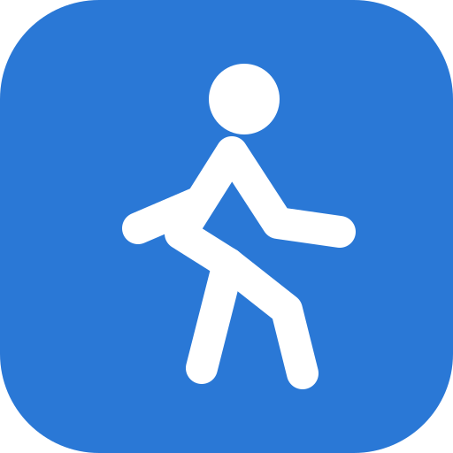
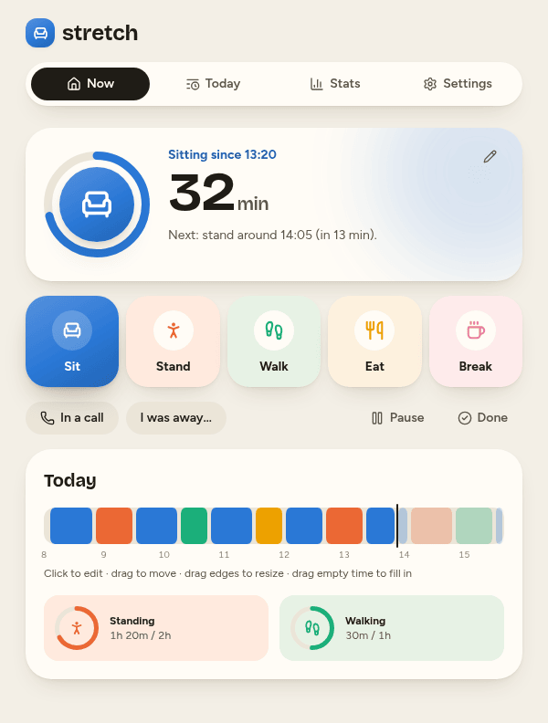
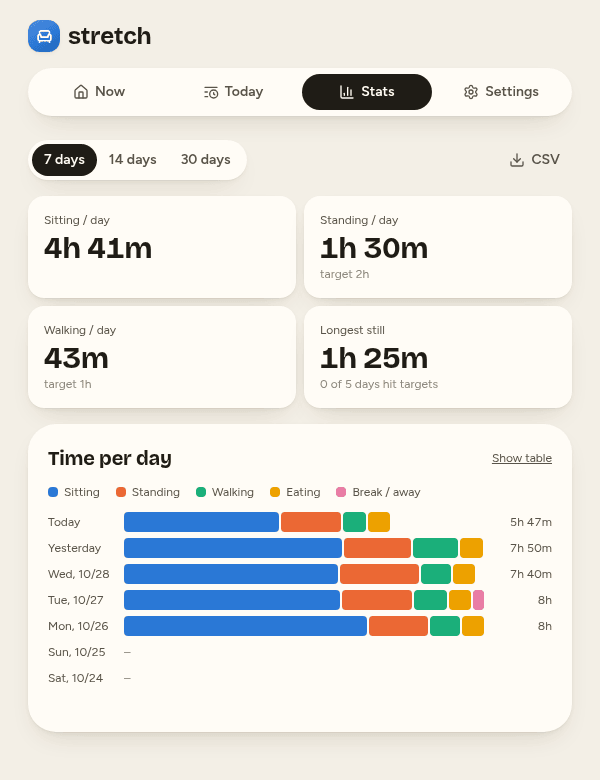

# Stretch

Stretch keeps a workday at a desk from turning into hours of sitting still.
You tell it what you're doing (sitting, standing, walking on a walking pad,
eating, on a break) with one tap or key, and it suggests when to switch, with a
chime and a desktop notification. It's a small self-hosted web app meant for
one person across a few devices.

<p>
  
  
</p>

The suggestions are only suggestions. Switching is always one tap, "Not now"
backs off, and nothing blocks you. Posture suggestions ping once; only the
stillness alarm (sitting or standing too long without any change) escalates.

## What's in it

The Now page shows what you're doing and for how long, the next suggestion,
today's timeline and your standing and walking targets. Keys 1–5 (or s, t, w,
e, b) switch activity and n snoozes a suggestion. "In a call" mutes alerts, and
"I was away…" logs a break you forgot to record. If you switched late, "Started earlier?" backdates the change, and
Adjust lets you rewrite the recent past ("sitting since 10:30, standing before
that").

The timeline is editable: click a block to change it, drag it to move it, drag
its edges to resize it, or drag across empty time to fill it in. Today lists
every change, Stats shows time per activity per day as a chart or table with a
CSV export, and Settings holds the workday, limits, targets and alarm timing.

In Chrome and Edge, idle time and a locked screen count as away (via the Idle
Detection API). Every browser notices when the machine was asleep.

Settings and activity sync live between devices. Each device keeps an offline
outbox, so changes made without a connection are saved when it comes back.
Equipment, alert and sound preferences are per device. The requirements and
planner rules are in [docs/PLAN.md](docs/PLAN.md).

## Running it

The backend is a small Rust (axum + SQLite) server that also serves the built
React UI. Everything runs in the Nix dev shell:

```sh
nix develop
npm ci
cargo run --manifest-path backend/Cargo.toml   # API on 127.0.0.1:3005, data in ./data
npm run dev                                    # UI on :3105, proxies /api
```

The server reads three environment variables: `STRETCH_BIND` (default
`127.0.0.1:3005`), `STRETCH_DATA_DIR` (default `data`) and
`STRETCH_STATIC_DIR` (default `dist`).

## Deploying

CI publishes `ghcr.io/fruitiex/stretch` from `main`. The image is built with
Nix (`nix build .#container`), listens on port 8080 and keeps its SQLite
database in `/data`:

```sh
docker run -p 8080:8080 -v stretch-data:/data ghcr.io/fruitiex/stretch:main
```

Stretch has no authentication, so only expose it on a private network or
behind a reverse proxy that handles access for you. If the proxy has a request
timeout, disable it for `/api/live`, which is a long-lived server-sent events
stream. `stretch-api --backup <dest>` writes a consistent copy of the
database.

## Checks

```sh
cargo fmt --manifest-path backend/Cargo.toml -- --check
cargo clippy --manifest-path backend/Cargo.toml --all-targets -- -D warnings
cargo test --manifest-path backend/Cargo.toml
npm run format:check
npm run typecheck
npm test                 # planner, timeline and idle logic
npm run build
cargo build --manifest-path backend/Cargo.toml && npm run test:ui
nix build .#container && docker load < result && node scripts/verify-container.mjs
```

`npm run test:ui` drives the built app in Chromium against a temporary
database, using a fake clock for suggestions, notifications and sleep and two
browser contexts for live sync. It writes screenshots to `test-results/`.

`npm run sounds` renders every alert sound to WAV in `test-results/sounds/`
with peak and loudness figures, for tuning by ear.

## License

MIT, see [LICENSE](LICENSE).
